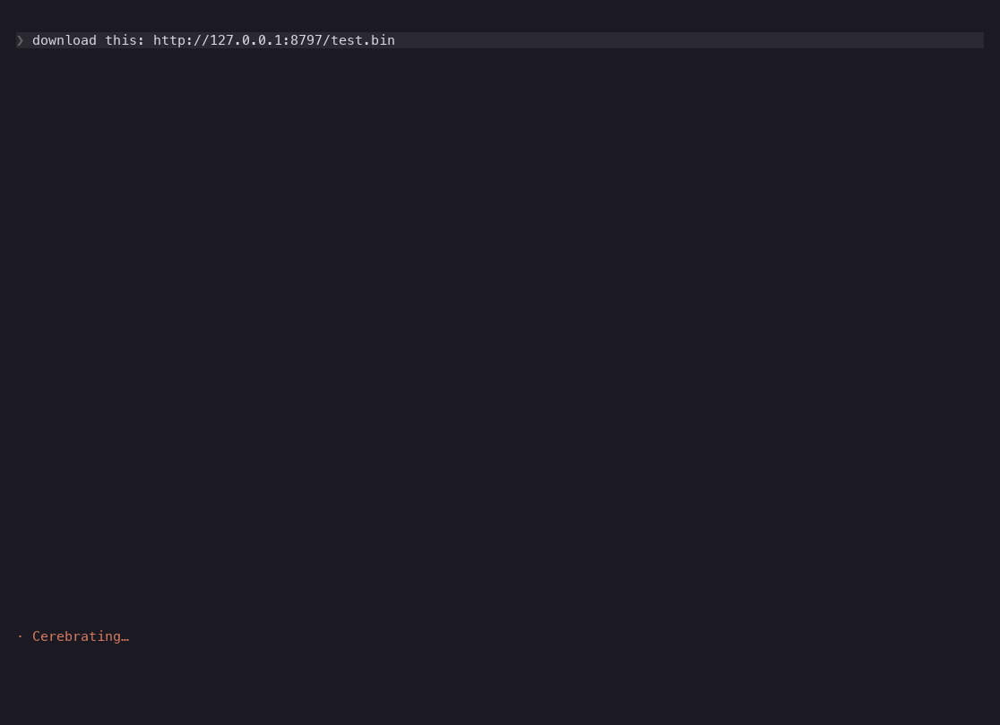
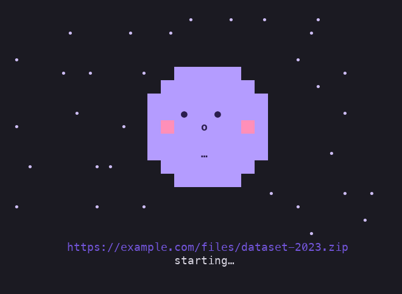

# IDM for Agent

A download manager made for AI agents, written from scratch in Python with only the standard library. The command is `idm`, and it ships as a Claude Code plugin.


In Claude Code, halo plays live under the agent's own `idm get` command:



*A real Claude Code session (Haiku), recorded in a hidden terminal, downloading from idm's local test server.*

## Why an agent needs it

When an agent (Claude Code, Codex, Cursor...) downloads a file, it usually runs `curl` and hopes. A slow download gets its tool call cut off. A 403 or a 429 comes back as a wall of text, or gets saved under the file's name and reported as done.

idm is built so the agent always knows where it stands:

- **One line of JSON per command.** It's short, so it costs few tokens.
- **Every failure has a fixed error code,** says whether retrying helps, and has a `hint` saying what to do.
- **`next` is the exact command to run next,** when there is one.
- **An error page is never saved as the file.** A 404, a login wall or a web page is an error with a code, not a download.
- **Big downloads carry on in the background,** so the agent's tool call is never cut off halfway.

## halo

The person beside the agent sees the download as halo: a face inside a ring of 32 dots. Each dot is 1/32 of the file. It floats until its share arrives, then flies home. The face is happy while it downloads, sad when the server pushes back or the download fails, asleep when paused, and cheers at 100%.



*A dead link: idm's `NOT_FOUND` message and hint, under a sad face.*

The halo GIFs are rendered from [`idm/halo.py`](idm/halo.py), the same code that draws halo in a terminal and in Claude Code, fed made-up status over time. The agent spends no tokens on halo: it still gets its one line of JSON, and the face is drawn beside it from the job's `status.json`.

## Install in Claude Code

From GitHub (while the repo is private, your GitHub login needs access to it):

```
claude plugin marketplace add Ajinkya259/idm-for-agent
claude plugin install idm-for-agent@idm-for-agent
```

Or try it from a clone, without installing:

```
claude --plugin-dir .
```

Then ask: "download this: https://...". This repo is the plugin. It puts `idm` on the agent's PATH, adds a skill that teaches the agent when to use it and what to do for each error code, and adds the halo mod.

It needs Python 3.9 or newer and nothing else. It's tested on macOS with Python 3.9 and 3.14.

## Use it from a terminal

```
bin/idm get URL                 download it and wait (an agent gets a reply within 90 s)
bin/idm start URL               start in the background and reply at once
bin/idm wait ID [--max S]       wait for it to finish
bin/idm status ID               how it's going right now
bin/idm watch [ID|LINK]         show it as halo (no ID: every download, as it happens)
bin/idm list                    every download
bin/idm pause | resume | cancel ID

options for get / start:
  -o NAME   -d FOLDER   --header 'Name: value'   --cookies cookies.txt   --allow-page   --again
  --connections N
```

In a true-colour terminal of at least 56 x 23, `idm get` and `idm wait` show halo. People get readable text; agents get JSON.

## The agent contract

```
$ idm get https://example.com/big.iso
{"ok": true, "job": "3f9a1c", "state": "downloading", "file": "/Users/you/big.iso", "bytes": 52000000,
 "size": 700000000, "percent": 7, "speed": 4100000, "eta": 158, "next": "idm wait 3f9a1c"}

$ idm get https://example.com/members/report.pdf
{"ok": false, "job": "77b0e2", "state": "failed",
 "error": {"code": "AUTH_REQUIRED", "message": "the server said 403 Forbidden", "retryable": false,
           "hint": "The server wants a login. Ask the user for a cookies.txt file ..."},
 "next": "idm get https://example.com/members/report.pdf -d /Users/you --cookies <cookies.txt>"}
```

- **Error codes:** `BAD_URL`, `BAD_INPUT`, `NOT_FOUND`, `AUTH_REQUIRED`, `NOT_A_FILE`, `HTTP_ERROR`, `RATE_LIMITED`, `SERVER_ERROR`, `NETWORK`, `TLS`, `FILE_CHANGED`, `DISK_FULL`, `NO_PERMISSION`, `WRITE_FAILED`, `INTERRUPTED`, `NO_SUCH_JOB`, `INTERNAL`.
- **Exit codes:** 0 fine, 1 failed, 2 the command itself was wrong, 3 failed but worth retrying (run `next`).
- **Running the same command twice is safe.** `idm get URL` finds the earlier job for that link and folder: it waits for it, carries on with it, or replies `"already": true`. `--again` forces a fresh download.

The full table of error codes, when each happens and whether it's retryable, is in [docs/GUIDE.md](docs/GUIDE.md#the-error-codes).

## The eval

[`eval/run_eval.py`](eval/run_eval.py) runs Claude Code on its own (`claude -p`), the way τ-bench tests agents. Each run is a real agent in an empty folder, asked "Download this for me: URL", while a local server misbehaves in one set way. A program grades how it ended: is the right file on disk, byte for byte, or, where there is no file to get, was the user told why? Each scenario runs with idm and with plain tools (curl, wget...).

Results (Sonnet, 7 scenarios, both ways, 2 trials each, run twice):

| Scenario | What goes wrong | with idm | plain tools |
|---|---|---|---|
| plain | nothing | 4/4 | 4/4 |
| busy | 429 Too Many Requests 3 times first | 4/4 | 3/4: curl saved the empty 429 reply as the file, and said it was done |
| drops | the connection is cut once | 4/4 | 4/4 |
| not_found | the link is dead (404) | 4/4 | 4/4 |
| web_page | the link is a download page that links to the file | 4/4 | 4/4 |
| login | needs a login; the scripted user hands over cookies | 4/4 | 3/4: saved the 9-byte "forbidden" reply as the file, and called it downloaded |
| big | 10 MB from a slow server that allows 2 connections | 4/4, **112 s** | 4/4, 207 s |
| **total** | | **28/28** | **26/28** |

A strong model with curl gets there most of the time. Its failures are the quiet kind: an error reply saved under the file's name, reported as success. idm's replies make that impossible to miss, and its connections make the slow server about twice as fast. More in [docs/GUIDE.md](docs/GUIDE.md#the-eval).

## How it works

- **Many connections.** idm's first request asks for one byte. Then a free connection takes the second half of the biggest piece still missing, and writes straight into its place in the `.part` file (1 to 16 connections, default 8). When a server limits connections, an extra one hands its piece to the others, rests and comes back.
- **Resume.** The `.part.json` notes list the pieces still missing, so a pause, a crash or a cut connection carries on exactly where it was. 429s, 5xx and network errors are retried with waits before idm gives up with a code.
- **ETag checks.** Every piece is checked against the file's ETag. If the file changes on the server mid-download, idm says `FILE_CHANGED` instead of saving a mix of two versions.
- **Background jobs.** Each download is a job with its own folder under `~/.idm/jobs/<id>/`, run by a worker process that rewrites `status.json` about 5 times a second. `idm get` replies within 90 s; `idm wait` picks up from there.
- **halo in Claude Code.** The plugin's mod ([`hooks/halo.tsx`](hooks/halo.tsx)) watches for `idm get` and `idm wait`, starts `idm watch --cells`, and paints each frame under the command.

## How it was built

One phase at a time, each tested before the next. Each phase's own code and notes are kept in the history ([phases 1 to 5 as they were](https://github.com/Ajinkya259/idm-for-agent/tree/f5c8106)); the code here is the latest.

| Phase | What | State |
|---|---|---|
| [1](https://github.com/Ajinkya259/idm-for-agent/tree/f5c8106/phase1) | One connection, done properly: Range requests, `.part` files, resume, retries, changed-file detection | done, 20 tests |
| [2](https://github.com/Ajinkya259/idm-for-agent/tree/f5c8106/phase2) | The agent contract: the `idm` CLI, JSON replies, error codes and hints, background jobs | done, 55 tests |
| [3](https://github.com/Ajinkya259/idm-for-agent/tree/f5c8106/phase3) | Many connections at once, and "take half of the biggest piece left" (the trick that makes IDM fast) | done, 68 tests |
| [4](https://github.com/Ajinkya259/idm-for-agent/tree/f5c8106/phase4) | halo, the face: in the terminal (`idm get`, `idm watch`), and live under the agent's command in Claude Code | done, 87 tests + 4 for the mod |
| [5](https://github.com/Ajinkya259/idm-for-agent/tree/f5c8106/phase5) | The Claude Code plugin (idm on the agent's PATH, a skill, halo), a τ-bench-style eval, and a critic's review, fixed | done, 100 tests + 5 for the mod |
| 6 | Scheduling, a queue, a speed limit | in progress |

```
python3 tests/run_tests.py      # 100 checks: every command, every error code, the pieces, halo
claude plugin test .            # the mod: which commands it watches, the face under them
```

The UI experiments that led to halo are in the history too ([mockups](https://github.com/Ajinkya259/idm-for-agent/tree/f5c8106/mockups)).

## Status

Private for now. No license yet.
