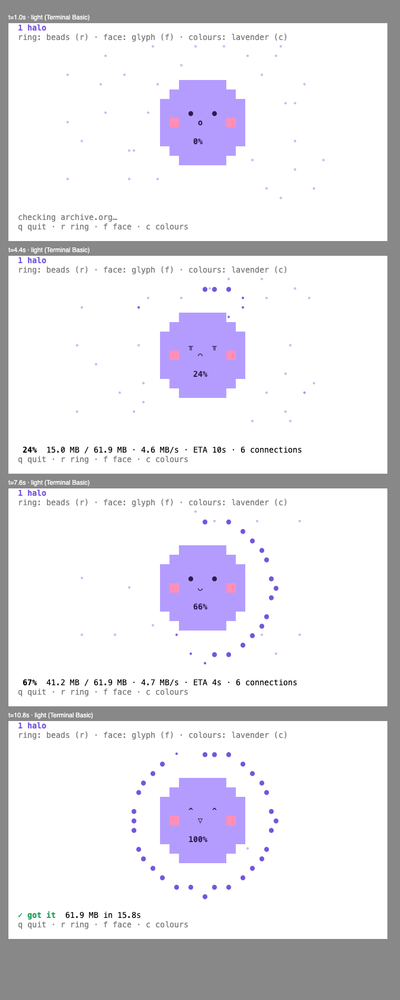

# tako

A download manager made for AI agents, and for the people working beside them. It's written from scratch in Python, using only the standard library, to learn how download managers like IDM work inside.



## Why

When an AI agent (Claude Code, Codex, Cursor...) downloads something today, it usually runs `curl` and hopes. If the download is slow, its tool call gets cut off. If the server says 403 or 429, the agent gets back a wall of text it has to guess at.

tako is built so the agent always knows where it stands:

- **Every reply is one short line of JSON.**
- **Every failure has a fixed error code,** says whether retrying helps, and gives a hint saying what to do.
- **There's always a `next` command** to run, when there is something to run.
- **Big downloads carry on in the background,** while the agent checks in on them.

The person beside the agent gets to *see* the download as **halo**: a small face that fills its ring of dots as the file arrives, gets sad when the server pushes back, and cheers when it's done.

## Status

The project is built one phase at a time, and each phase keeps its own folder, so you can read how it grew.

| Phase | What | State |
|---|---|---|
| [phase1](phase1/) | One connection, done properly: Range requests, `.part` files, resume, retries, changed-file detection | ✅ done, 20 tests |
| [phase2](phase2/) | The agent contract: the `tako` CLI, JSON replies, error codes and hints, background jobs | ✅ done, 55 tests |
| phase 3 | Many connections at once, and "take half of the biggest piece left" (the trick that makes IDM fast) | next |
| phase 4 | halo in the terminal (`tako watch`), and as a live view inside Claude Code | planned |
| phase 5 | A Claude Code plugin, and a τ-bench-style evaluation of how well agents recover from errors | planned |

[mockups](mockups/) has the UI experiments that led to halo. `python3 mockups/experiments.py halo` plays it, with a pretend download.

## Try it

```
cd phase2
bin/tako get https://proof.ovh.net/files/10Mb.dat
bin/tako start https://proof.ovh.net/files/100Mb.dat     # replies at once; then:
bin/tako wait <job>
python3 tests/run_tests.py                               # every command and error code
```

It needs Python 3.9 or newer and nothing else. It's tested on macOS with Python 3.9 and 3.14.
